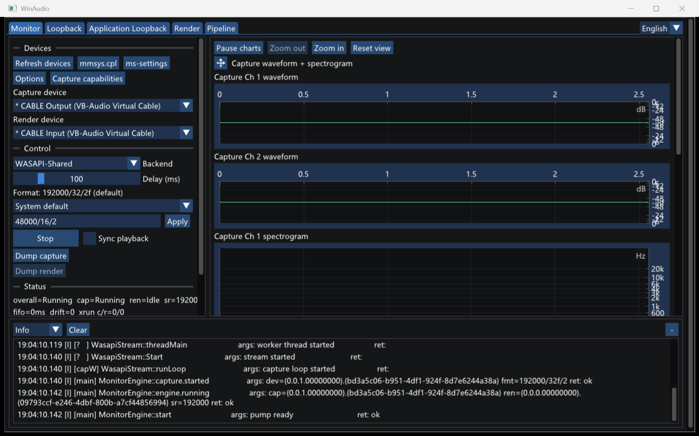

# WinAudio

[中文](README.zh-CN.md)

[](https://github.com/peilinok/winaudio/actions/workflows/ci.yml)

A small Windows audio test tool. It captures, plays, loopbacks, and listens for latency on system audio devices, with a live waveform and spectrogram. The GUI (Dear ImGui + DX11) is the preferred interface. A small CLI is included.

## Screenshot



More GUI modes are in [GUI screenshots](docs/gui-screenshots.md).

## Features

- **Two WASAPI backends**: Shared and Exclusive (low latency). The same flow can switch backend for a comparison.
- **Capture / playback**: capture writes a WAV file, and playback reads a standard RIFF WAV. `--format` sets the target format (Shared is converted by the WASAPI engine `AUTOCONVERTPCM`; Exclusive requires native hardware support).
- **System loopback**: a render endpoint is the **Capture source** for the system output. An optional silent render keepalive keeps the clock moving. The GUI Loopback page can run several **Capture Track**s at once.
- **Application Loopback**: WASAPI process loopback by PID (Shared-only; Windows 10 build 20348+). The default is **IncludeTree** (the target process and its child tree only). **ExcludeTree** takes the process-loopback mix except that process tree. The GUI Application Loopback page is also a list of Capture Tracks.
- **Dual-stream latency listener**: **Monitor** is still one pair: exactly one Capture Track, plus at most one Render Track (capture → fixed-delay FIFO with drift compensation → render). It shows the fifo level, drift, and xrun. Neither the GUI nor CLI `monitor` is a multi-track list.
- **Device capabilities**: Mix / Device / OEM formats, plus a Shared/Exclusive support matrix for the candidate formats.
- **Format probe**: checks whether a device supports a format (shared reports what the WASAPI mixer can convert; exclusive reports native exclusive availability).
- **Live analysis**: a dB time-domain waveform and a scrolling log-frequency spectrogram (built-in radix-2 FFT, Hann window, dBFS). On the GUI capture side, 2ch+ formats are drawn per channel.
- **Detailed API logs**: parameters and return values of WASAPI/COM/Win32 calls are observable (spdlog, level adjustable at runtime).

## Download and run

- Download `WinAudio-<version>-win-x64.zip` or `WinAudio-<version>-win-x86.zip` from [Releases](https://github.com/peilinok/winaudio/releases) and unzip it.
- The executables use the static CRT and are self-contained. **No VC++ Redistributable install is required.**
- System: Windows 10/11 x64. The GUI needs Direct3D 11. Application Loopback needs Windows 10 build 20348 or newer (Windows 11 / Windows Server 2022+).

## Build

Requires Visual Studio 2022 (v143 toolset + Windows SDK) and CMake ≥ 3.21 (the copy bundled with Visual Studio is enough).

```powershell
git clone --recursive https://github.com/peilinok/winaudio.git   # spdlog is a git submodule
cd winaudio

.\build.bat Release        # Release is the default; pass Debug; --clean wipes first
.\test.bat Release         # run the suite (ctest / gtest)
```

Outputs are in `build\bin\<Config>\`: `WinAudioGui.exe`, `WinAudioCli.exe`, and `WinAudioTests.exe`.

- If `cmake` / `ctest` are not on PATH, use the copy shipped with Visual Studio (`<VS install>\Common7\IDE\CommonExtensions\Microsoft\CMake\CMake\bin`).
- Or use the CMake preset: `cmake --preset vs2022`, then `cmake --build build --config Release -j`.
- A Windows SDK older than 10.0.20348 still builds. Application Loopback is compiled out and reports an error at runtime.

## GUI use (preferred)

Run `WinAudioGui.exe`. The window has **Monitor** / **Loopback** / **Application Loopback** tabs. The log defaults to `winaudio.log` in the working directory (double-click starts in the exe directory). The log panel can change the level, clear, and follow the latest line while running.

Domain terms: a **Track** is one one-way stream (capture or playback) that is created and destroyed on its own. Create opens the stream immediately; there is no idle Track. A **Capture source** is the recipe (device, or PID + mode), not the running stream. A **Capture Track** binds one Capture source, and the GUI can Dump / Stop dump at any time. **Monitor** is the only dual-stream session name. A **Chart Host** is one chart's toolbar plus its panels. Each loopback page has its own list, empty at startup. Leaving the tab does not stop capture.

### Monitor (dual-stream latency listener)

Two columns: devices, control, status, and the log on the left; capture and playback "waveform + spectrogram" units on the right. A 1-channel capture format stays one view. At 2ch+, each channel's waveform is stacked as `Ch N`, then each channel's spectrogram (the first 8 channels, with `8 / N channels` when there are more). The channels advance on the same capture end index. Playback stays one delayed view. The charts share a time axis. The divider in a mono or playback unit moves vertically, and the units can be reordered by dragging.

- **Devices**: pick the capture device (the system default starts selected) and the backend (Shared / Exclusive). "Capture caps…" shows that device's three format sources and the Shared/Exclusive matrix.
- **Format**: the format that will be used (for example `48000 Hz, 16-bit, 2-ch`). The first combo entry is System default, then the candidates the current backend supports, and Custom for a manual entry. Changing the device or backend recomputes the default.
- **Control**: "Options" sets advanced stream parameters before Start: per capture/render `SetClientProperties` enable, category, offload, stream option (None / Raw / MatchFormat / Ambisonics / Post-volume loopback), ducking (render only), and buffer ms. The dialog is editable only before Start. The **Sync playback** checkbox starts and stops the render passthrough while running (Exclusive requires the render device to support the capture format). **Dump capture** / **Dump render** each open and close a WAV sink at any time (pick a folder, automatic file name; Dump render is disabled while playback is off).
- **Status**: live fifo ms / drift, for watching cross-device clock drift.
- Monitor stays one session. Start / Stop controls that pair. There is no "Destroy all" that clears lists on other pages. DelayFifo belongs to Monitor, not to a Track.

### Loopback (system loopback)

This page is a list of System Loopback **Capture Track**s (Shared-only), not one Start/Stop.

- **Create Track**: pick a render device as the Capture source. The Format combo is System default (no requested format, so the mix format is used), plus that render device's Shared candidates, plus Custom Apply (`sr/bits/ch[f]`, same as Monitor). Options are the capture column (Set client properties, category, offload, stream option, buffer; no Ducking and no AutoConvert control) and are written into the next Create's Stream params. Silent render keepalive defaults on, always uses the full default mix, and does not inherit this page's recipe. Create opens the stream immediately. There is no second Start step. The same render device can have several tracks. This page's recipe is not shared with Monitor or Application Loopback. Destroy and leaving the tab do not clear the recipe.
- **Destroy** / **Destroy all**: Destroy removes that one track (capture, the silent render helper, a WAV if that track is dumping, and that track's charts). Destroy all clears only this page. It does not touch Application Loopback or Monitor.
- The right side is one Capture-only **Chart Host** per track (waveform + spectrogram; at 2ch+, `Ch N` stays inside that Track, first 8 channels). Chart freeze and the linked time axis are per Track. Tracks do not share a time axis or a format.
- **Dump** / **Stop dump**: each track has its own WAV sink, which can start and stop while the track is running. Start dump picks a folder. The file name is a fixed prefix, the actual format, and a timestamp. After Stop dump (or Destroy) succeeds, Explorer selects that file. Tracks are not mixed into one stream or one file.

### Application Loopback (per-process loopback)

This page is a list of Application Loopback Capture Tracks (Create / Destroy / Destroy all, stacked Chart Hosts, and an independent Dump per track). The Capture source is a **PID + IncludeTree / ExcludeTree**. The Format combo has only System default, plus Custom Apply (no microphone or speaker candidate list). Options are the same capture column. Create sends that page's Stream params into the open (and calls SetClientProperties when enabled). The recipe is not shared with Monitor or System Loopback. Dump file names include the process name and PID. Destroy removes that one track. Destroy all clears only this page's Application Loopback Capture Tracks. It does not touch the Loopback page or Monitor. A running track row shows the actual format only.

Opening the tab enumerates processes that currently have an Audio Session (process name + PID, sorted by process name). "Refresh" enumerates again. The session list is for discovery: clicking a row copies the PID into the input, and any non-zero PID can be typed (it does not have to be in the list). Clicking the list does not open a stream.

The **PID** input and the **Exclude** checkbox (unchecked by default) belong to the next Create. They are stored on that Track's Capture source. The mode of a running track does not change. To change the mode, or to capture the same PID again, Create another track. The same PID with a different mode is not an equal Capture source. The same PID and mode can still be opened twice.

| Mode | UI | Track state | Meaning (Windows process tree) |
|------|----|-------------|-------------------------------|
| **IncludeTree** (default) | Exclude unchecked | `IncludeTree` | Capture only the target PID and its **child process tree** |
| **ExcludeTree** | Exclude checked | `ExcludeTree` | Capture the process-loopback mix **except** that process tree |

## CLI use

`WinAudioCli.exe <subcommand> [options]`. Subcommands: `list` / `caps` / `probe` / `capture` / `play` / `monitor` / `effects`.

### list — enumerate devices

```powershell
WinAudioCli list [--render|--capture] [--effects]
```

Render devices are listed by default. `*` marks the system default. The line also prints the mix format, the device id (for `--device` / `--cap`), and endpoint enhancement status (`enhancements=on|off|unknown` plus APO CLSID slots when published).

`--effects` additionally opens a short Shared stream per device (Initialize, **no Start**) and prints stream-level effects from `IAudioEffectsManager` (`type:on|off[+set]`). Requires **Windows 11 build 22000+**; on Windows 10 or when the manager is unavailable the line is `streamEffects=(none)`. Enumeration without `--effects` never opens a stream.

### effects set — configure a stream effect

```powershell
WinAudioCli effects set [--capture|--render] [--device <id>] <effect> on|off
```

Opens a short Shared stream (Initialize, **no Start**), calls `IAudioEffectsManager::SetAudioEffectState` when `canSetState` is true, then re-lists effects. `<effect>` may be a braced GUID, a known type name (`"Noise Suppression"`), or a kebab/underscore slug (`noise-suppression`). Fails cleanly on Windows 10, missing manager, unknown effect, or read-only (`canSetState=false`) effects. Default flow is render.

### caps — device capabilities

```powershell
WinAudioCli caps [--device <id>] [--render|--capture]
```

Shows Mix / Device / OEM formats, and whether each candidate is supported in Shared / Exclusive (`yes` / `-`).

### probe — format probe

```powershell
WinAudioCli probe --format 48000/16/2 [--device <id>] [--render|--capture] [--backend wasapi-shared|wasapi-exclusive]
```

Prints `SUPPORTED` / `NOT SUPPORTED` (exit code 0 / 1). Exclusive reports native exclusive availability. Shared reports whether the WASAPI mixer can convert the format (whether this tool can use it).

### capture — capture

One `capture` command is a set of **Capture Track**s that share the process lifetime (`--seconds` / Ctrl+C stops them together). The set itself is not a Track.

```powershell
# one track (no --track; compatible with older scripts)
WinAudioCli capture --out <file.wav> [--seconds N] [--device <id>] [--loopback]
                    [--pid N] [--exclude-tree] [--no-silent-render]
                    [--backend wasapi-shared|wasapi-exclusive] [--format 48000/16/2]

# a set: one segment per --track, and each segment needs its own --out
WinAudioCli capture --track --out a.wav --loopback --track --out b.wav --pid 4242 [--seconds N]
```

- No `--track`, and a single `--out`: still one Capture Track.
- Repeated `--track`: one track per segment. `--pid` in a segment (optional `--exclude-tree`) is Application Loopback; otherwise `--loopback` is System Loopback; otherwise Endpoint. An omitted `--device` uses the default device for that kind. `--pid` and `--loopback` in the same segment is a usage error.
- `--format` and `--no-silent-render` are per segment. `--backend` and `--seconds` are once for the set.
- A set can mix Endpoint / System Loopback / Application Loopback. Equal Capture sources may be opened together. One track's Error does not stop the others. Any failed track makes the exit code non-zero.
- One WAV per track. Tracks are not mixed into one file. The default capture is 5 seconds. The status line prints `tracks=` plus level / overrun.
- With `--loopback`, `--device` is a render device id. Loopback is Shared-only. A silent render keepalive starts by default. `--no-silent-render` turns it off (System Loopback segments only).
- `--format` works for both backends. Shared is converted by the WASAPI engine (this tool has no resampler). Exclusive requires native hardware support (a loopback segment is still rejected because it is Shared-only).

### play — playback

```powershell
WinAudioCli play --in <file.wav> [--device <id>] [--backend wasapi-shared|wasapi-exclusive]
```

The format is read from the WAV header. `--format` is not accepted. In Shared, the WASAPI engine converts to the device mix format. Exclusive requires the device to support the WAV format natively.

### monitor — dual-stream latency listener

```powershell
WinAudioCli monitor [--cap <id>] [--render <id>] [--delay-ms N] [--seconds N] [--loopback]
                    [--no-silent-render] [--format 48000/16/2] [--backend wasapi-shared|wasapi-exclusive]
```

- Capture → fixed delay (default 100 ms) → render passthrough, for 5 seconds by default. The status line prints cap/ren state, sample rate, fifo ms, drift, and xrun.
- `--format` applies to the capture side only.
- Shared: the WASAPI engine bridges the sample rate on the render side, so capture and render can use devices with different rates. Exclusive: the render device must support the capture format, or render fails to start.
- `--loopback` uses the render endpoint as the capture source (`--cap` is a render device id) and is Shared-only. Do not use the same render device as both the loopback input and the monitor output.
- `monitor` is still a single Monitor pair and does not accept a `--track` list. `list` / `caps` are not Track lists either.

### Common options

- `--log-level <trace|debug|info|warn|err>` (default `info`) and `--log-file <path>`: logs go to stderr, and the status line goes to stdout (so either can be redirected). `--log-file` also writes a file.
- `--format` syntax is `rate/bits/channels[f]`, for example `48000/16/2` or `48000/32/2f` (`f` means float).
- Device ids come from `list`.

## Logging

- Levels: `Info` (default; stream lifetime: open/close/start/stop, the selected device, and the final format); `Debug` (parameters and return values on the control path, with HRESULT names such as `AUDCLNT_E_DEVICE_INVALIDATED`); `Trace` (per buffer on the audio thread; for diagnosis, and it can slightly disturb the audio under test).
- GUI: the log panel (level can change while running) plus `winaudio.log` in the working directory (rotating file).
- CLI: stderr, plus an optional `--log-file`.

## Known limits

- **No resampler**: Shared depends on the WASAPI engine to convert formats. Exclusive requires native hardware support. Monitor in Exclusive requires the render device to support the capture format (otherwise render fails to start).
- **Drift compensation is a single-frame drop or insert plus a crossfade**: device pairs across clock domains (for example a USB microphone and an HDMI output) drift quickly. Loopback on the same interface drifts very little.
- On the GUI capture side, a 2ch+ waveform / spectrogram is drawn per `Ch N`, for at most the first 8 channels. Playback visuals and the level meter stay a mono downmix.
- System loopback and Application Loopback support the Shared backend only.
- Application Loopback Exclude applies to the **whole target process tree** (including child processes). It is not an arbitrary multi-PID filter. It is a different path from the System Loopback tab, so compare them by what you hear.
- Capture Tracks are independent. They are not mixed into one audio stream or one WAV. There is no product cap on how many run at once, and no number here is a Windows / WASAPI limit.
- waveIn / waveOut (the MME backend) is not implemented.


## License

MIT. See [LICENSE](LICENSE).

## Development

- The developer guide (build details, architecture, and coding constraints) is [CLAUDE.md](CLAUDE.md). Domain terms are in [CONTEXT.md](CONTEXT.md). Design documents for each feature are under `docs/superpowers/specs/`, and implementation plans are under `docs/superpowers/plans/`.
- CI: a push or PR to `main` builds and tests Debug + Release. Pushing a `v*` tag publishes a Release. The `Release` workflow can also be started by hand from the GitHub Actions page. A manual run builds Release, runs the tests, and uploads a zip artifact. It does not create a GitHub Release.
