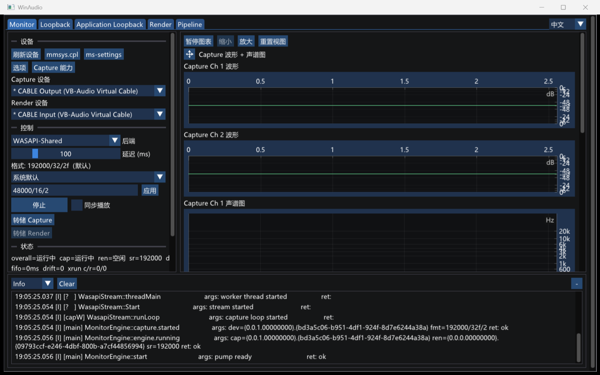

# WinAudio

[English](README.md)

[](https://github.com/peilinok/winaudio/actions/workflows/ci.yml)

小巧的 Windows 音频测试工具：对系统音频设备做采集、播放、回环（loopback）与延迟监听测试，带实时波形 / 声谱图可视化。桌面界面使用 Dear ImGui + DX11。

## 运行截图



更多 GUI 模式截图见 [GUI screenshots](docs/gui-screenshots.zh-CN.md)。

## 功能

- **WASAPI 双后端**：Shared（共享模式）与 Exclusive（独占模式、低延迟），同一流程可切换后端做对比测试。
- **采集 / 播放**：Capture Track 支持随时开始或停止 WAV Dump；Render Track 播放声道识别语音。目标格式在 GUI 中选择（Shared 通过 WASAPI `AUTOCONVERTPCM` 转换；Exclusive 要求硬件原生支持）。
- **系统 loopback**：以 render endpoint 为 **Capture source** 回采系统输出，可选静音 render keepalive 保持时钟推进。GUI Loopback 页可同时跑多路 **Capture Track**。
- **Application Loopback**：按 PID 做 WASAPI process loopback（Shared-only；Windows 10 build 20348+）。默认 **IncludeTree**（只采目标进程及其子进程树）；可选 **ExcludeTree**（采 process-loopback 混音中除该进程树以外的部分）。GUI Application Loopback 页同样是多路 Capture Track。
- **双流延迟监听**：**Monitor** 仍是一对：正好一路 Capture Track，加上至多一路 Render Track（capture → 固定延迟 FIFO（漂移补偿）→ render），显示 fifo 水位 / drift / xrun。Monitor 不做多路列表。
- **设备能力查询**：Mix / Device / OEM 三来源格式 + 候选格式在 Shared/Exclusive 下的支持矩阵。
- **格式探测**：检测设备是否支持指定格式（shared 反映 WASAPI 混音器转换能力，exclusive 反映硬件独占可用性）。
- **实时分析**：dB 时域波形 + 滚动 log 频率声谱图（自带 radix-2 FFT，Hann 窗，dBFS 标定）；GUI 采集侧 2ch+ 按实际 channel 分开显示。
- **详细接口调用日志**：所有 WASAPI/COM/Win32 调用的参数与返回值可观测（基于 spdlog，级别运行时可调）。

## 下载与运行

- 从 [Releases](https://github.com/peilinok/winaudio/releases) 下载 `WinAudio-<版本>-win-x64.zip` 或 `WinAudio-<版本>-win-x86.zip`，解压即用。
- exe 使用静态 CRT，自包含，**无需安装 VC++ Redistributable**。
- 系统要求：Windows 10/11 x64；GUI 需要 Direct3D 11；Application Loopback 功能需要 Windows 10 build 20348 及以上（Windows 11 / Windows Server 2022+）。

## 从源码构建

依赖：Visual Studio 2022（v143 工具集 + Windows SDK）、CMake ≥ 3.21（VS 自带的即可）。

```powershell
git clone --recursive https://github.com/peilinok/winaudio.git   # spdlog 为 git submodule
cd winaudio

.\build.bat Release        # 默认 Release；可传 Debug；--clean 先清后建
.\test.bat Release         # 运行测试套件（ctest / gtest）
```

产物在 `build\bin\<Config>\`：`WinAudioGui.exe`、`WinAudioTests.exe`。

- 若 `cmake` / `ctest` 不在 PATH，可用 VS 自带的（`<VS 安装目录>\Common7\IDE\CommonExtensions\Microsoft\CMake\CMake\bin`）。
- 也可直接用 CMake preset：`cmake --preset vs2022`，然后 `cmake --build build --config Release -j`。
- Windows SDK 低于 10.0.20348 时仍可构建，但 Application Loopback 功能会被编译为不可用（运行时报错提示）。

## GUI 使用

端点音频增强开关只能在开始音频流之前修改。需要管理员权限时，GUI 会弹出 UAC，并启动自身的第二个实例完成这一项操作；取消或失败会显示在原窗口。辅助实例不创建窗口、不启动音频流，执行后立即退出。

运行 `WinAudioGui.exe`，包含 **Monitor** / **Loopback** / **Application Loopback** 三个 tab。日志默认写运行目录下的 `winaudio.log`（双击启动即 exe 目录），左栏日志面板可运行时切换级别、清空、自动滚动。

领域用语：**Track** 是一路可单独创建/销毁的单向流（采集或播放），Create 立即开流，没有 idle Track；**Capture source** 是配方（设备 / PID+mode），不是正在跑的那一路；**Capture Track** 绑定一个 Capture source，GUI 上可随时 Dump / Stop dump；**Monitor** 是唯一的双流会话名；**Chart Host** 是一路图的工具栏 + 面板。两个 loopback 页各自一份列表，每次启动为空；切走 tab 不会停采集。

### Monitor（双流延迟监听）

两列布局：左列为设备 / 控制 / 状态 / 日志，右列为采集、播放两路「波形 + 声谱图」单元。采集端实际格式为 1ch 时保持单张视图；2ch+ 时按 `Ch N` 垂直堆叠显示各 channel 的 waveform，再显示各 channel 的 spectrogram（最多前 8 个 channel，超出时标出 `8 / N channels`），并按同一 capture end index 同步推进。播放端仍为单张延迟播放视图。所有图共享时间轴，单声道/播放单元中间分割线可上下调节，单元可拖拽重排。

- **Devices**：选择采集设备（默认系统默认设备）与后端（Shared / Exclusive）；「Capture caps…」弹窗显示该设备的三来源格式与 Shared/Exclusive 能力矩阵。
- **Format**：显示当前将用格式（如 `48000 Hz, 16-bit, 2-ch`）；候选下拉第一项为 System default，随后是当前后端支持的候选格式，末项 Custom 可手动输入；切换设备或后端时自动重算默认值。
- **Control**：「Options」弹窗配置高级流参数——capture/render 各自的 `SetClientProperties` 总开关、category、offload、stream option（None / Raw / MatchFormat / Ambisonics / Post-volume loopback）、ducking（仅 render）、buffer ms；弹窗仅 Start 前可改。「同步播放」checkbox 实时启停 render 直通流（Exclusive 模式要求渲染设备支持采集格式）。**Dump capture** / **Dump render** 各自随时开停 WAV sink（选文件夹、自动命名；播放未开时 Dump render 禁用）。
- **Status**：实时显示 fifo ms / drift，方便观察跨设备时钟漂移。
- Monitor 保持单一会话：Start / Stop 控制这一对，没有「Destroy all」跨页清列表。DelayFifo 属于 Monitor，不是 Track。

### Loopback（系统回采）

本页是一份 System Loopback **Capture Track** 列表（Shared-only），不是单路 Start/Stop。

- **Create Track**：选一个 render device 作为 Capture source。Format 下拉为 System default（不传 requested，走 mix）+ 当前 render 设备 Shared 候选 + Custom Apply（`sr/bits/ch[f]`，与 Monitor 相同）。Options 为采集列（Set client properties、category、offload、stream option、buffer；无 Ducking、无 AutoConvert 控件），写入下一次 Create 的 Stream params。Silent render keepalive 默认开启，且始终全默认 mix，不继承本页配方。Create 立即开流，没有第二步 Start。同一 render device 允许同时开多路。本页配方与 Monitor / Application Loopback 互不共用；Destroy 和切 tab 不清配方。
- **Destroy** / **Destroy all**：Destroy 只拆这一路（采集、silent render helper、该路若在 dump 则收尾 WAV、该路图）。Destroy all 只清本页，不动 Application Loopback 或 Monitor。
- 右侧为每路独立的 Capture-only **Chart Host**（波形 + 声谱图；2ch+ 时 `Ch N` 拆分仍在该 Track 内，最多前 8 个 channel）。Chart freeze 与 linked time axis 按 Track，路与路不共享时间轴或格式。
- **Dump** / **Stop dump**：每路独立、运行中随时开停的 WAV sink。Start dump 选保存文件夹，文件名按固定 prefix、实际格式和时间戳生成；Stop dump（或 Destroy）成功后用资源管理器选中该文件。多路不会混成一个流或一个文件。

### Application Loopback（按进程回采）

本页是一份 Application Loopback Capture Track 列表（Create / Destroy / Destroy all、堆叠 Chart Host、每路独立 Dump）。Capture source 是 **PID + IncludeTree / ExcludeTree**。Format 下拉只有 System default，外加 Custom Apply（没有麦克风或扬声器候选表）。Options 同采集列，Create 把该页 Stream params 送进开流（enabled 时会 SetClientProperties）。配方与 Monitor / System Loopback 互不共用。Dump 文件名带进程名和 PID。Destroy 只拆这一路；Destroy all 只清本页的 Application Loopback Capture Track，不动 Loopback 页或 Monitor。运行中 Track 行只显示实际格式。

打开 tab 后自动枚举当前有 Audio Session 的进程（进程名 + PID，按进程名排序），「Refresh」重新枚举。Session 列表只做发现：点击一行把 PID 填入输入框，也可手输任意非零 PID（不必出现在列表中）。点列表不会开流。

**PID** 输入 + **Exclude** checkbox（默认未勾选）属于下一次 Create 的配方，写入该 Track 的 Capture source。已在跑的那一路 mode 不再改；要换 mode 或再采同一 PID，再 Create 一路即可。同 PID 不同 mode 不是相等 Capture source；同 PID+mode 也允许同时开两路。

| 模式 | UI | 该路状态 | 语义（Windows process tree） |
|------|----|----------|------------------------------|
| **IncludeTree**（默认） | Exclude 未勾 | `IncludeTree` | 只采集目标 PID 及其**子进程树**的音频 |
| **ExcludeTree** | 勾选 Exclude | `ExcludeTree` | 采集 process-loopback 混音中**除**该进程树以外的部分 |

### Pipeline（Live 会话 API 监控）

在 **PID** 框输入目标进程（或点选 Live 会话自动填入）后点 **附加 (Attach)** 注入 `WinAudioHook.dll`（需同位数）；**不要求**该进程已有 Live 会话。在调用日志中查看 Core Audio / WASAPI COM 调用、参数与 HRESULT。Hook 列与 PID 框下方状态对应该 PID 显示已附加 / 失败 / 未附加（即使不在会话列表中）。**分离 (Detach)** 会安静停止采集并解除映射。可选 **录制调用 / 保存调用**，JSONL 默认写入 `%LOCALAPPDATA%\\WinAudio\\pipeline-calls`。GetBuffer/ReleaseBuffer 的 pump 元数据默认关闭。处理图会标明 Initialize 字段来源（无/ETW/Hooked）、Shared 探针的 Probed 与 Observed 区别，以及多路 Hooked 流时使用最新一路；图只合并所选 Live 会话 PID。这不是完整 API Monitor：仅闭合 COM 集合、无调用栈、无跨位数注入。

- 一轮观察可同时附加多个 PID，分离单个或全部 PID 后仍保留本轮调用，供查看和保存。全部分离后再次附加，会先提示保存、放弃或取消；新目标实际附加成功才替换旧轮，失败保留旧记录。
- **录制调用**控制保存范围，关闭后仍继续接收和显示控制调用。从未开启录制时保存全部历史；开启时纳入当时全部历史并跟随新增，关闭时冻结上界。例如先收到 A、B，开启后收到 C，关闭后收到 D，界面可看 A～D，保存 A～C。再次开启会重新纳入当时全部历史。
- 空录制范围会明确提示，不回退保存后来收到的记录。pump 只显示近期元数据；选中项移出窗口后清除选择并提示，不自动跳到另一条调用。主表摘要保持单行，完整内容可悬停查看或在参数面板查看。
- **保存调用**在后台执行，每次只允许一个任务；保存期间可继续浏览和接收调用，暂不能替换整轮历史。退出时可等待保存完成或取消保存；取消须等当前写入返回，失败或取消均保留历史。

性能测量、复跑方法及已知验证限制见 [性能实施与验收记录](docs/measurements/performance-acceptance/README.md)。控制历史仍完整保存在内存，新增记录时内存会增长；本轮未加入长期归档。


## 日志

- 级别：`Info`（默认，流生命周期：open/close/start/stop、选中设备、最终格式）；`Debug`（所有控制路径调用的参数 + 返回值，HRESULT 译成符号名，如 `AUDCLNT_E_DEVICE_INVALIDATED`）；`Trace`（音频热路径逐帧，诊断用，开启时可能对被测音频有轻微扰动）。
- GUI：左栏日志面板（运行时切级别）+ 运行目录 `winaudio.log`（轮转文件）。

## 已知限制

- **无重采样器**：Shared 依赖 WASAPI 引擎转换格式；Exclusive 要求硬件原生支持；monitor 的 Exclusive 模式要求渲染设备支持采集格式（不匹配则 render 启动失败）。
- **漂移补偿为单帧丢/插 + crossfade**：跨时钟域设备组合（如 USB 麦克风 + HDMI 输出）漂移率高；同接口 loopback 漂移很小。
- GUI 采集侧 waveform / spectrogram 对实际 2ch+ 格式按 `Ch N` 分开显示，最多显示前 8 个 channel；播放端可视化与电平指示仍为单声道降混。
- 系统 loopback 与 Application Loopback 仅支持 Shared 后端。
- Application Loopback 的 Exclude 作用于**整个目标进程树**（含子进程），不是任意多 PID 过滤；与 System Loopback tab 路径不同，对比时请按实际听感理解。
- 多路 Capture Track 各自独立：不混成一路音频，也不合成一个 WAV。没有产品侧的并发路数上限，也不把某个数字写成 Windows / WASAPI 限制。
- waveIn / waveOut（MME 后端）未实现。

## 开发

- 开发者指南（构建细节、架构、编码约束）见 [CLAUDE.md](CLAUDE.md)；领域用语见 [CONTEXT.md](CONTEXT.md)；历次功能的设计文档在 `docs/superpowers/specs/`，实施计划在 `docs/superpowers/plans/`。
- CI：push / PR 到 `main` 自动以 Debug + Release 双配置构建并跑测试；推送 `v*` tag 自动发布 Release；`Release` workflow 也支持在 GitHub Actions 页面手动触发，手动运行会构建 Release、跑测试并上传 zip artifact，不创建正式 GitHub Release。
