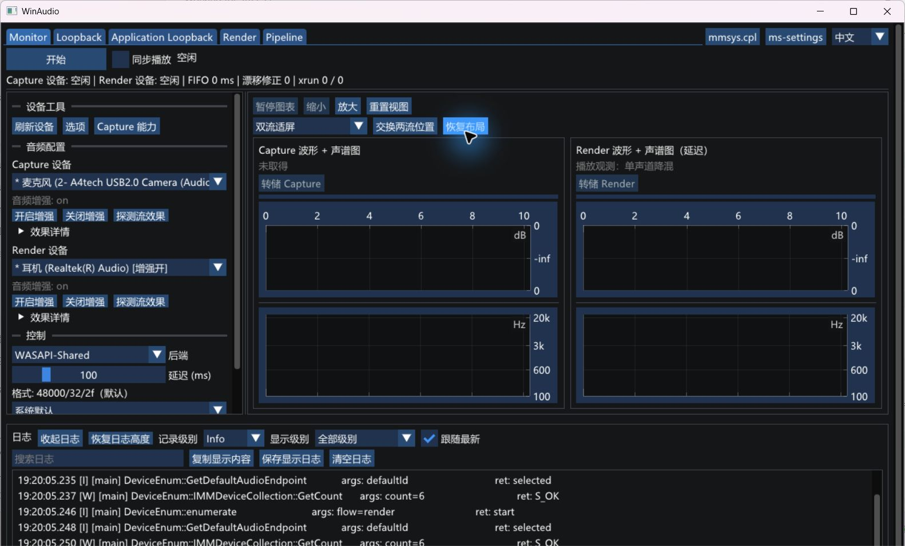
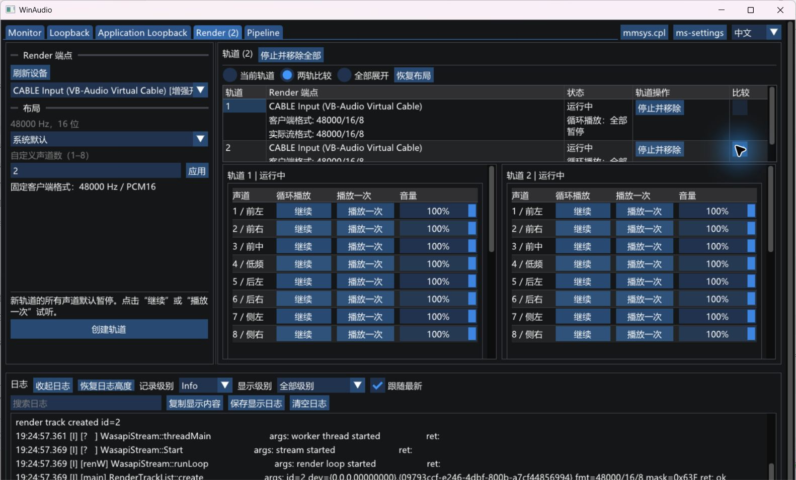
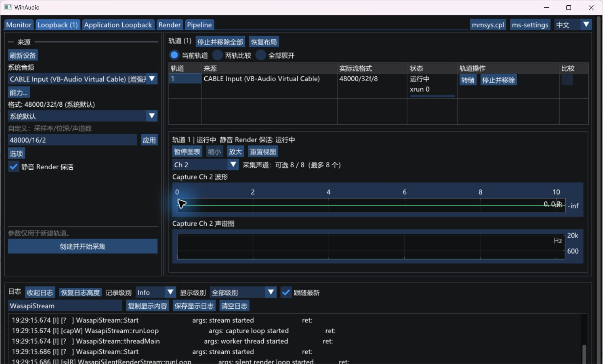
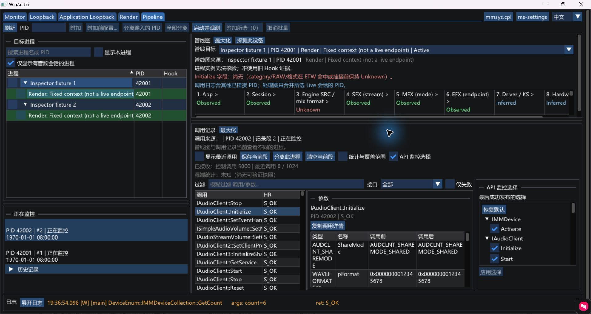
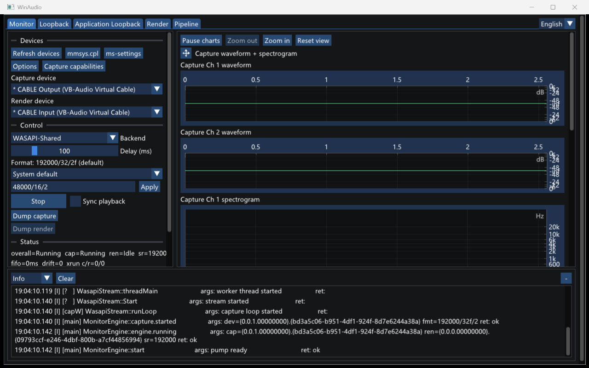
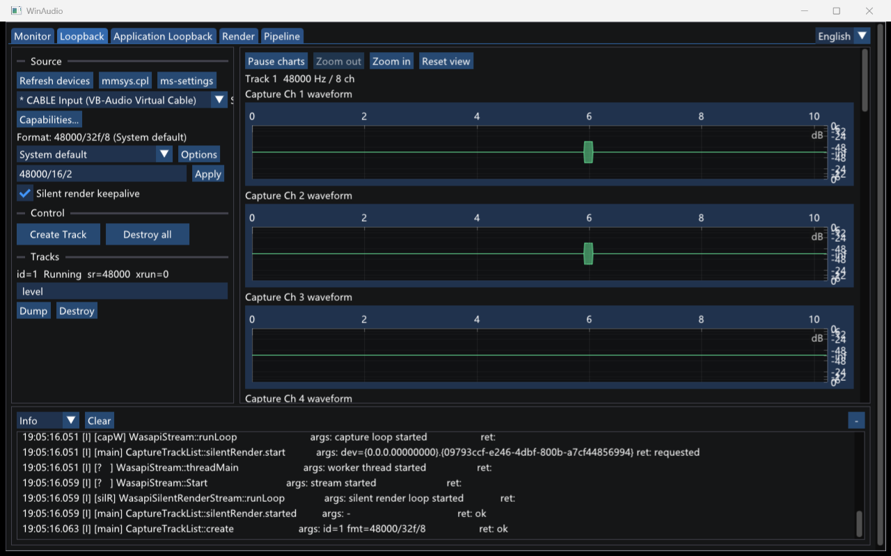
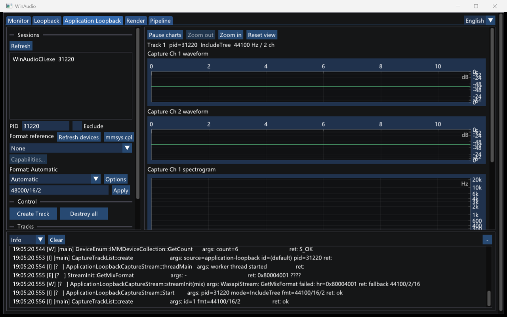

# GUI screenshots

[中文](gui-screenshots.zh-CN.md)

## Resizable workspaces (2026-11-09)

Captured from the GUI built at `6bd655a` during desktop smoke checks. Monitor is idle; the two Render tracks are paused. Loopback captures the eight-channel CABLE virtual endpoint with Ch 2 selected.

Pipeline uses the opt-in performance fixture with 10,000 synthetic calls across two synthetic PIDs. The graph shows PID 42001 while the call panel shows PID 42002. This illustrates independent selection; it is not evidence from an attached application or a performance benchmark.

The earlier captures below show previous layouts.

## Monitor

The dual-stream latency listener shows the capture and render waveforms and spectrograms together.

## Loopback

The Loopback page is a list of System Loopback Capture Tracks. Each track has its own Capture-only Chart Host and records the selected render endpoint. See the Loopback section in the README.

## Application Loopback

The Application Loopback page is also a Capture Track list. The Capture source is a PID plus IncludeTree or ExcludeTree. See the Application Loopback section in the README.

