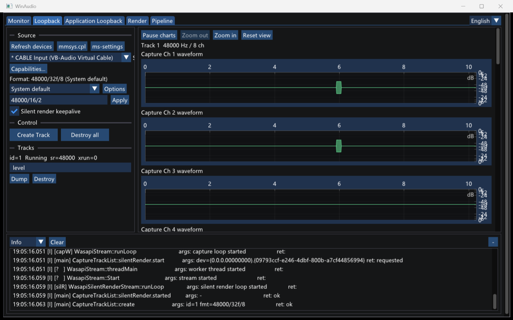
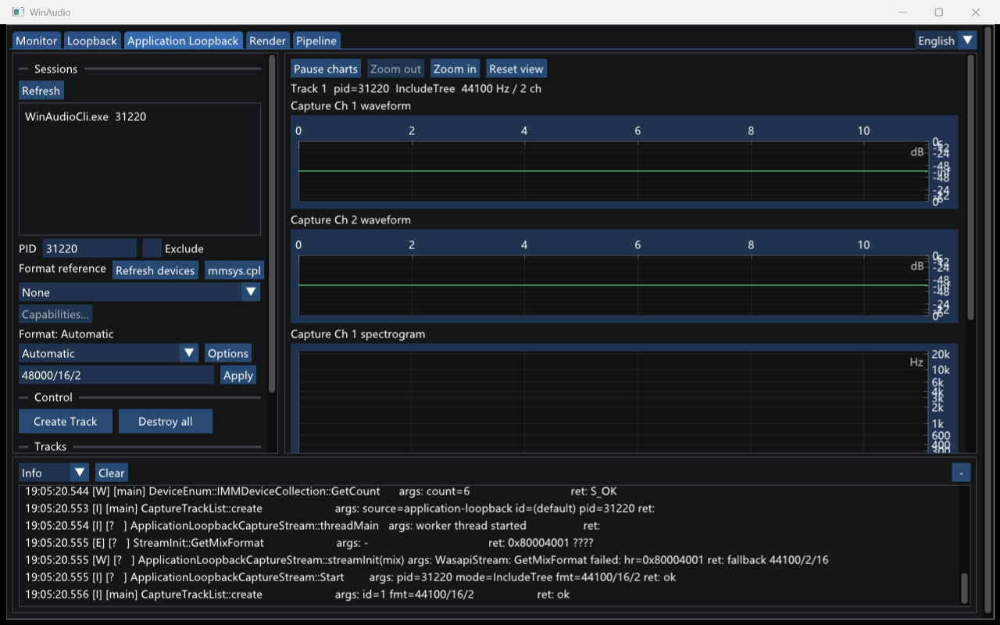

# GUI screenshots

[中文](gui-screenshots.zh-CN.md)

These screenshots are from a real WinAudio GUI session. They show the waveform, spectrogram, status, and log region for the main modes.

## Monitor

The dual-stream latency listener shows the capture and render waveforms and spectrograms together.

## Loopback

The Loopback page is a list of System Loopback Capture Tracks. Each track has its own Capture-only Chart Host and records the selected render endpoint. See the Loopback section in the README.

## Application Loopback

The Application Loopback page is also a Capture Track list. The Capture source is a PID plus IncludeTree or ExcludeTree. See the Application Loopback section in the README.

