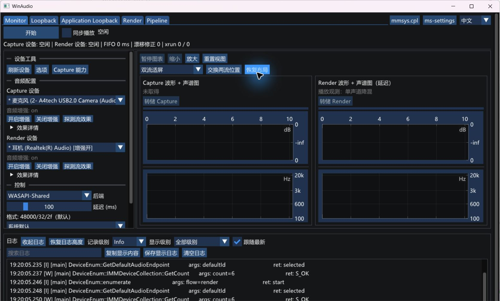
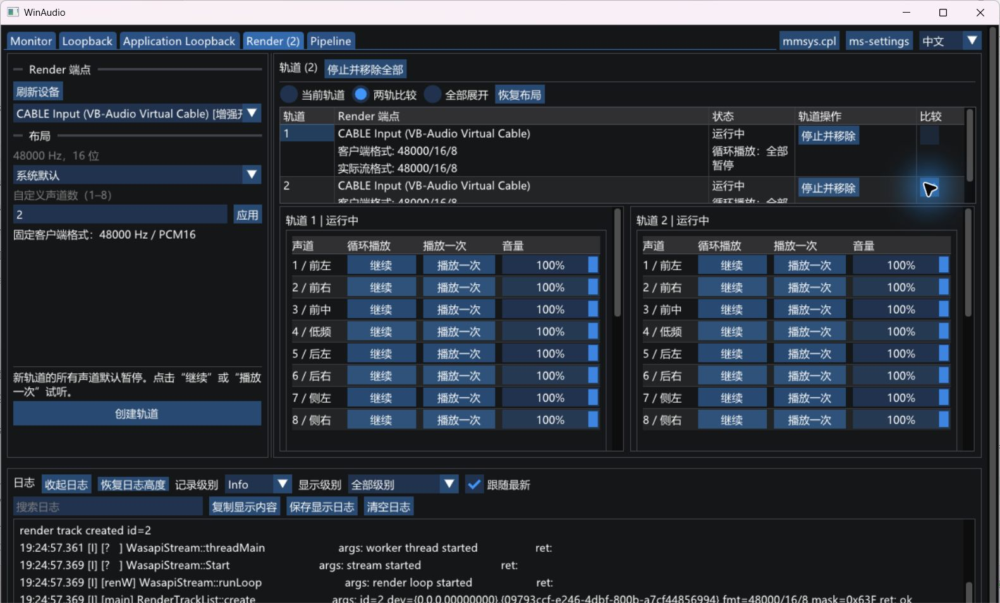
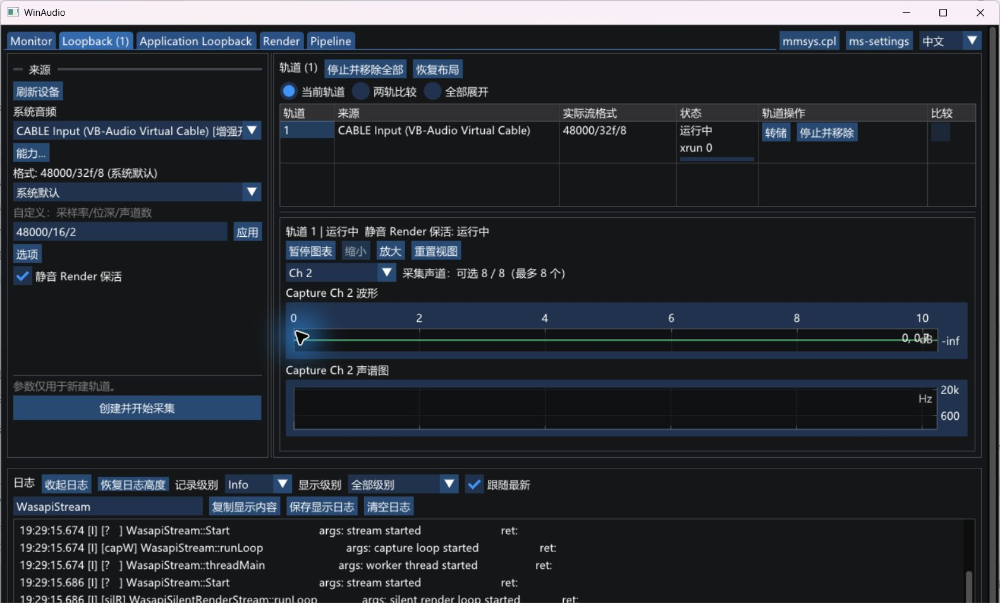
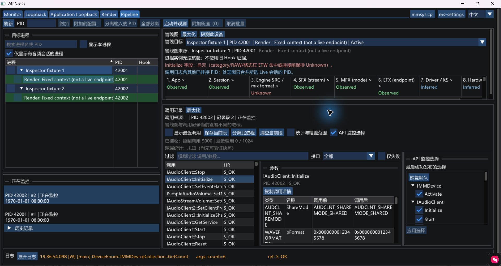
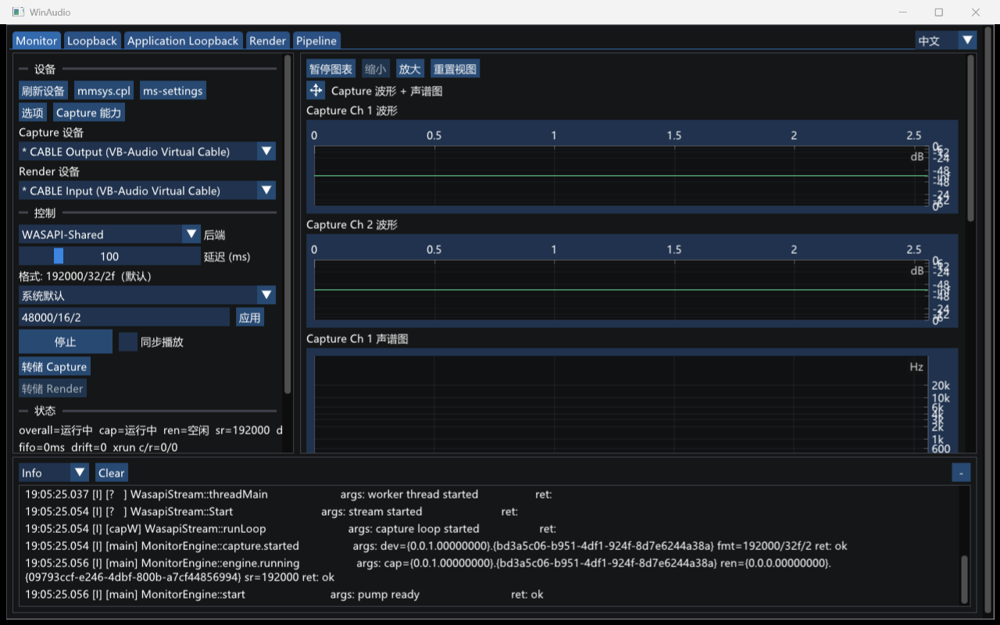
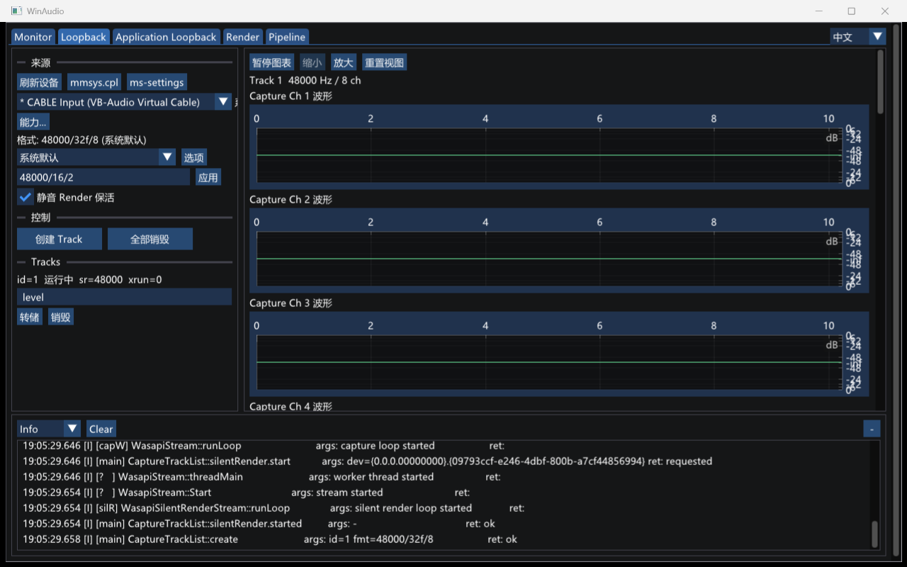
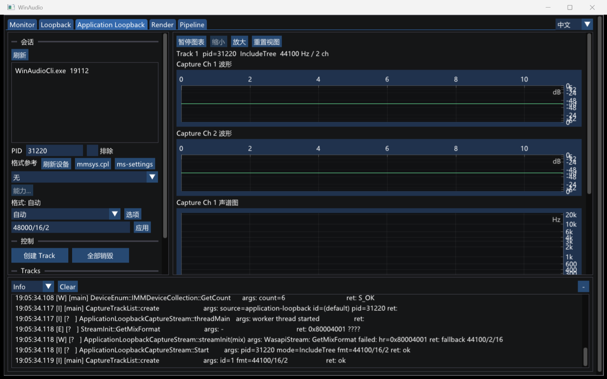

# GUI 截图

[English](gui-screenshots.md)

## 可调整的工作区（2026-11-09）

以下截图来自 `6bd655a` 构建版本的桌面验收。Monitor 处于空闲状态，两条 Render 轨道均已暂停；Loopback 正在采集八声道 CABLE 虚拟端点，图表选择 Ch 2。

Pipeline 使用可选测试程序生成的 10,000 条调用记录，分属两个模拟 PID。管线图选择 PID 42001，调用记录选择 PID 42002，展示两者可独立选择；这张截图不代表真实应用的接入结果或性能测量结果。

下方为此前版本的界面截图。

## Monitor

双流延迟监听模式同时展示采集端与渲染端的波形和声谱图。

## Loopback

Loopback 页是一组 System Loopback Capture Track：每路一个 Capture-only Chart Host，回采所选 render endpoint。详见 README Loopback 小节。

## Application Loopback

Application Loopback 页同样是 Capture Track 列表。Capture source 为 PID + IncludeTree / ExcludeTree。详见 README Application Loopback 小节。

