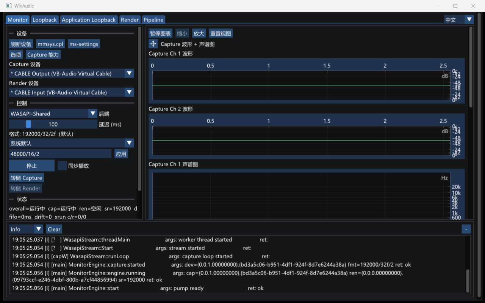
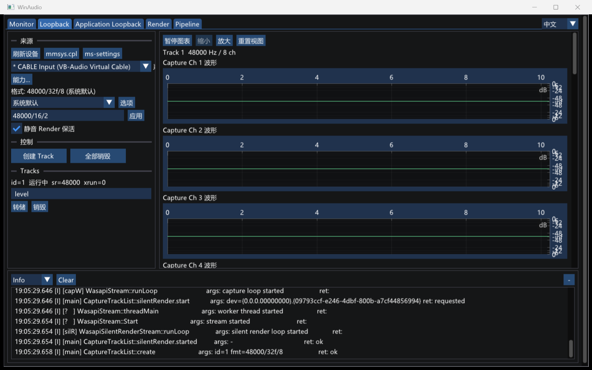
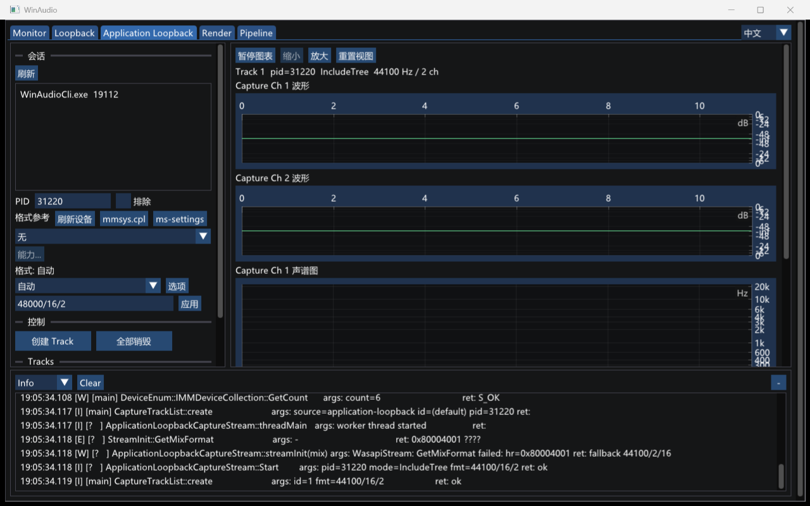

# GUI 截图

[English](gui-screenshots.md)

这些截图来自 WinAudio GUI 的真实运行状态，用于展示主要工作模式下的波形、声谱图、状态与日志区域。

## Monitor

双流延迟监听模式同时展示采集端与渲染端的波形和声谱图。

## Loopback

Loopback 页是一组 System Loopback Capture Track：每路一个 Capture-only Chart Host，回采所选 render endpoint。详见 README Loopback 小节。

## Application Loopback

Application Loopback 页同样是 Capture Track 列表。Capture source 为 PID + IncludeTree / ExcludeTree。详见 README Application Loopback 小节。

