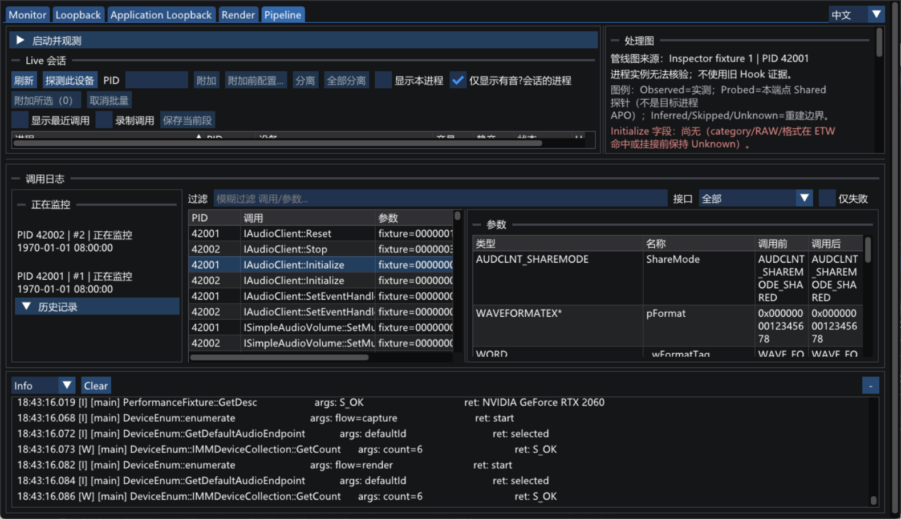

# 普通日志面板：筛选缓存与可见行绘制

日期：2026-11-08。范围：性能普查的问题 2。

干净 main 上，5000 行日志的主线程 p95 从 **3.01～3.03 ms 降到 0.58～0.59 ms**；每帧提交从完整 5000 行变成 9 行，预热后不再重复筛选或重算换行高度。原工作区带搜索控件的面板同样完成接入与对照，其他界面改动未纳入发布分支。

整个进程的 CPU 百分比有明显波动。虽然满日志场景从约 40% 单核降到 8.5%～18.3%，**“相对空面板额外 CPU 不超过 5 个百分点”尚未在所有对照中稳定通过**，不能将它列为无条件达成的验收项。下文保留所有轮次及同进程对照。

## 实现与行为

- `LogPanel.h` 缓存匹配行及其换行高度。筛选键标识全部筛选条件；静止时复用，追加时只检查新增行。原工作区的键同时包含搜索文字和显示级别。
- 原日志字符串继续保存在原来的有界容器中。新增稳定行号，前部淘汰或清空时推进；即使清空后补回相同行数，也不会误用旧缓存。缓存只保存行号与高度，不保存字符串地址。
- 通过累计高度二分定位可见范围，只提交屏内行、相邻缓冲行及一条用于复现初始基线的首行；跳过区域以布局占位保留完整滚动范围。完全被裁剪的子窗口直接跳过绘制。
- 宽度、字体、字号或行距改变时重新测量。当前 ImGui 对屏幕零点两侧的坐标向零取整，因此缓存保留两种像素步长；跳过区域的定位也保持小数行距下的取整顺序。该细节由实际 ImGui 顶点对照测试约束，升级 ImGui 时应继续运行这些测试。
- 折叠、展开后跟随底部、清空等原有入口保留。原工作区的搜索、显示级别、复制和保存逻辑保留；复制与保存仍遍历全部匹配日志，未缩减为屏内行。
- 每个匹配行的索引字段为 32 字节；5000 行约 156 KiB，另有 deque 管理开销。这是源码计算，不是进程内存差的实测归因。音频线程、日志写入级别、落盘和保留条数没有改变。

## 基线与测试

基准为 `d724a1bcd46226044364e6108218e7dd2ed39932`。本机 Release x64，Visual Studio 18 2026；GUI 使用现有 FrameProbe、生产绘制路径和 idle 性能夹具。记录源是 1000 条既有 Pipeline 夹具记录，未启动音频负载。

- 修改前的干净分支：Debug / Release 相关既有测试各 18/18 通过。原工作区包含额外 LogView 用例，各 20/20 通过。
- 两项新增工作量测试先在原样提取的完整遍历循环上失败：静止历史仍检查 5000 次、提交 5000 行，无匹配搜索仍检查 5000 次。
- 最终 Debug / Release 的 GUI 和测试构建均成功。干净分支相关测试各 **33/33** 通过；原工作区各 **35/35** 通过。
- 15 项新用例覆盖静止复用、无匹配、追加、容量内淘汰、清空后同数量替换、隐藏期间整体替换、计数重置、换行、空行、UTF-8、不同滚动位置、底部跟随、超高单条日志、自动滚动条、字体替换、字体缩放和小数行距。
- 绘制正确性使用原完整遍历作为独立参考，比较真实 ImGui 的文字顶点位置、UV、颜色、内容末端和滚动范围。没有以放宽误差来消除字体缩放或行距测试中的偏差。

## 独立进程对照

每组预热 10 秒、正式 20 秒，两轮；CPU 采样剔除前 11 秒。每个正式场景约 2880 帧，约 144 Hz。CPU 100% 表示一个逻辑核，主线程耗时不含 Present。构建、正式负载与大 trace 汇总分开执行。

“未填充”表示没有额外注入 5000 行，仍有程序自身启动日志；同进程对照会显式清空，得到真正的空面板。

| 工作区 / 场景 | 原单核 CPU，两轮 | 新单核 CPU，两轮 | 原主线程 p95，ms | 新主线程 p95，ms |
|---|---:|---:|---:|---:|
| 干净 main，未填充 | 15.62 / 21.16% | 12.22 / 2.60% | 0.576 / 0.382 | 0.586 / 0.583 |
| 干净 main，5000 行 | 40.08 / 39.67% | 8.71 / 18.32% | 3.005 / 3.028 | 0.588 / 0.577 |
| 原工作区，未填充 | 17.83 / 13.98% | 2.35 / 11.82% | 0.595 / 0.595 | 0.630 / 0.626 |
| 原工作区，5000 行 | 41.10 / 42.37% | 18.06 / 8.50% | 3.101 / 3.090 | 0.627 / 0.630 |
| 原工作区，5000 行无匹配搜索 | 26.60 / 28.77% | 5.51 / 6.30% | 1.677 / 1.792 | 0.614 / 0.614 |

优化后两个满日志场景的正式帧，筛选检查和高度缓存重算均为 **0 次/帧**；干净 main 每帧提交 **9 行**，原工作区为 **8 行**，无匹配搜索为 **0 行**。初次显示、筛选或布局变化时仍需要建立缓存，不宣称其成本为零。

满日志的 Private Bytes 峰值：main 原 85.61 / 86.08 MiB，新 86.85 / 85.81 MiB；原工作区原 87.02 / 86.20 MiB，新 85.77 / 86.82 MiB。短测量未发现明显内存增长，但不构成长期泄漏验收。

## 同进程交替对照与 CPU 目标

为检查进程重启之间的波动，又分别在两个优化后 GUI 中运行“空 20 秒 → 5000 行 20 秒 → 空 20 秒 → 5000 行 20 秒”。预热 10 秒，阶段由 GUI 的 QPC 标记；进程采样排除每段首尾各一秒，并额外采集 `QueryProcessCycleTime`。所有四段均保留，负的差值视为测量波动，不解释为日志让空界面更省 CPU。

| 工作区 / 对照 | 空 → 满，单核 CPU | 额外 CPU 百分点 | 空 → 满，百万周期/秒 | 主线程平均增量，ms/帧 |
|---|---:|---:|---:|---:|
| main，第 1 组 | 11.41 → 3.96% | -7.46 | 232.53 → 240.31 | 0.0123 |
| main，第 2 组 | 6.35 → 19.48% | +13.13 | 231.64 → 237.60 | 0.0224 |
| 原工作区，第 1 组 | 3.62 → 7.91% | +4.29 | 250.84 → 258.27 | 0.0229 |
| 原工作区，第 2 组 | 20.56 → 7.74% | -12.82 | 251.11 → 254.89 | 0.0064 |

main 两组的 CPU 差值均值为 +2.84 个百分点，但单组有 +13.13，不能据均值宣称目标稳定通过。处理器周期增量约为各自空面板的 1.5%～3.3%，与很小的主线程增量相符；周期数不直接换算成单核 CPU 百分比。本轮没有将百分比波动归因于某个驱动、调度策略或时钟机制。

## 发布边界与证据

干净 main 只有原来的简版日志工具栏，没有原工作区尚未提交的搜索、显示级别、复制、保存等界面调整。发布分支只接入共用缓存和裁剪模块；原工作区在原有控件处接入同一模块，并额外验证既有 LogView 用例。两个工作区的 `LogPanel.h` 和新增测试逐字节相同。两类 GUI 数值分列，不能跨布局当作同一版本的前后数据。

- 汇总：`metrics.json`、`gui-summary.csv`；源码与二进制身份：`manifest.json`。
- 原始逐帧 trace、进程采样、QPC 阶段标记、红灯记录、测试 XML 和构建日志：本机 `.scratch/log-panel-2026-11-08/`。
- `tools/` 是可独立构建的测量夹具，未接入根构建、发布包或产品环境变量。
- 截图为单独运行，临时将被测窗口移到屏幕内以完整显示日志区域；截图运行不计入上述性能统计。前后外观保持一致，动态时间戳不同。
- 本轮没有 ETW 采样栈、GPU 执行时间、其他机器或长期运行证据。全进程 CPU 增量目标的波动仍是测量限制，未通过改帧率、关闭换行、截断日志或修改音频路径来规避。




## 复现

在仓库根目录先完成 Release GUI 构建，以下输出目录须使用新名字：

```powershell
$repo = (Get-Location).Path
cmake --build build --config Release --target WinAudioGui WinAudioTests --parallel 8
cmake -S docs/measurements/2026-11-08-log-panel/tools -B .scratch/log-panel-repro
cmake --build .scratch/log-panel-repro --config Release --target LogPanelSurvey --parallel 8
py -3 -B docs/measurements/2026-11-08-log-panel/tools/run_gui.py --root $repo --exe .scratch/log-panel-repro/Release/LogPanelSurvey.exe --output .scratch/log-panel-full --lines 5000
py -3 -B docs/measurements/2026-11-08-log-panel/tools/run_gui.py --root $repo --exe .scratch/log-panel-repro/Release/LogPanelSurvey.exe --output .scratch/log-panel-alternate --lines 0 --alternate
.\build\bin\Release\WinAudioTests.exe --gtest_filter="LogPanel.*:LogRegionPrefs.*:CallLogFilter.*"
```
