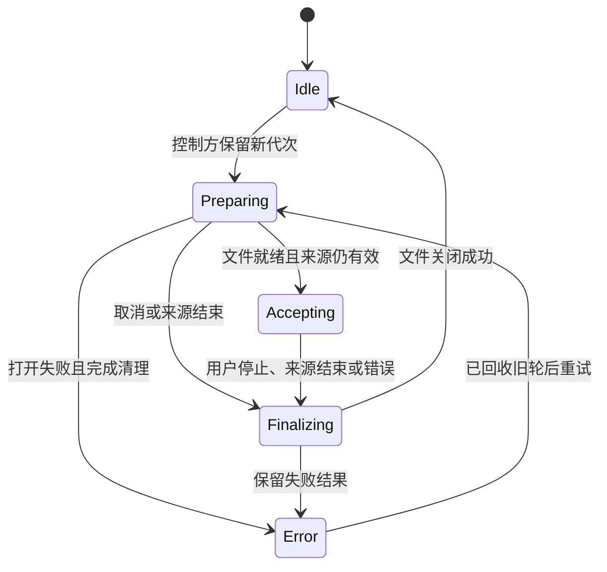
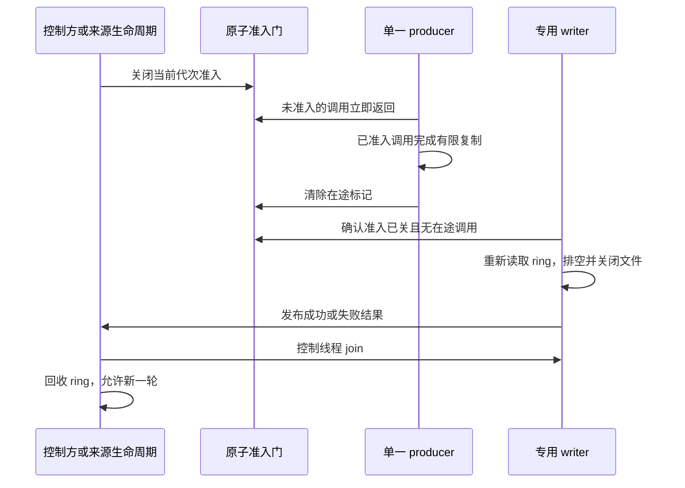

# WAV Dump 并发生命周期设计

设计已确定。#233 已实现 WavSink 原子准入、Capture Track 独立停止/重启与文件失败隔离；#234 已接入 Monitor 来源快照、自动停用和 GUI 收尾状态。逐项验收与红绿证据分别见[#233 执行记录](../../measurements/wav-dump-233/execution.md)、[#234 执行记录](../../measurements/wav-dump-234/execution.md)，未完成的实测与发布检查仍以执行记录为准。

基线为 `3c433575f0bfc77808eaa09113ba1eb2052ffb4e`。它已合并上一轮性能优化；WavSink、CaptureTrackList、MonitorEngine 与上一份架构报告基线 `6d0f3ef` 的对应源码没有差异。

## 目标与取舍

在 Track 持续运行时安全开始和结束 WAV Dump。优先保证内存安全、接收边界与文件结果正确，再把生产路径同步成本限制为固定数量的原子操作。

选择现有 WavSink module 内的“带代次原子准入门 + SPSC byte ring + 专用 writer”。不新增录制管理层，不把 Track 与 Monitor 合并成通用 Engine。

这项设计提供明确的热路径成本约束；绝对最高性能需要同负载测量，当前不声称已证明性能排名。

## 设计时源码证据

以下固定到设计基线 `3c433575f0bfc77808eaa09113ba1eb2052ffb4e`，是修复前的源码分析。实施中已用确定性交错证实尾部丢失与跨轮次混写，未把这些结果表述为已复现崩溃。性能与设备结果单独记录。

| 位置 | 当前行为 | 本轮必须处理的结果 |
| --- | --- | --- |
| [WavSink.cpp:139](https://github.com/peilinok/winaudio/blob/3c433575f0bfc77808eaa09113ba1eb2052ffb4e/src/core/WavSink.cpp#L139) | push 分别检查 state、running、ring，再访问 unique_ptr | 检查通过不等于已取得资源使用权 |
| [WavSink.cpp:152](https://github.com/peilinok/winaudio/blob/3c433575f0bfc77808eaa09113ba1eb2052ffb4e/src/core/WavSink.cpp#L152) | stop 关闭 running，只 join writer，再 reset ring | 没有等待在途 producer，存在释放后访问风险 |
| [WavSink.cpp:224](https://github.com/peilinok/winaudio/blob/3c433575f0bfc77808eaa09113ba1eb2052ffb4e/src/core/WavSink.cpp#L224) | writer 看到停止且 ring 空就退出 | 最后一次已获准 push 可能尚未发布数据，存在尾部丢失风险 |
| [CaptureTrackList.cpp:336](https://github.com/peilinok/winaudio/blob/3c433575f0bfc77808eaa09113ba1eb2052ffb4e/src/core/CaptureTrackList.cpp#L336) | pump 退出时直接 stop sink | 与控制方的 live stop 共用阻塞生命周期操作 |
| [MonitorEngine.cpp:367](https://github.com/peilinok/winaudio/blob/3c433575f0bfc77808eaa09113ba1eb2052ffb4e/src/core/MonitorEngine.cpp#L367) | pump 停用 render 时同步 stop Render Dump | 文件收尾可能拖住同一 pump 上的 capture |
| [MonitorEngine.cpp:548](https://github.com/peilinok/winaudio/blob/3c433575f0bfc77808eaa09113ba1eb2052ffb4e/src/core/MonitorEngine.cpp#L548) | pump 退出时同步停止两个 sink | 回收归属分散在 pump 与 teardown |
| [AppUi.cpp:2795](https://github.com/peilinok/winaudio/blob/3c433575f0bfc77808eaa09113ba1eb2052ffb4e/src/gui/AppUi.cpp#L2795) | GUI 关闭播放时先同步停止 Render Dump | 只改 pump 仍无法消除这条文件等待路径 |
| [MonitorEngine.cpp:405](https://github.com/peilinok/winaudio/blob/3c433575f0bfc77808eaa09113ba1eb2052ffb4e/src/core/MonitorEngine.cpp#L405) | GUI 根据 Running 状态读取 pump 可再次修改的 renderFmt | 状态检查本身不能保护来源格式快照 |
| [CaptureTrackList.cpp:413](https://github.com/peilinok/winaudio/blob/3c433575f0bfc77808eaa09113ba1eb2052ffb4e/src/core/CaptureTrackList.cpp#L413) | live start 修改 pump 会读取的 wavFatal | 文件错误策略应随 Track 创建固定，不在 live start 中改写 |
| [test_wav_sink.cpp](https://github.com/peilinok/winaudio/blob/3c433575f0bfc77808eaa09113ba1eb2052ffb4e/src/tests/test_wav_sink.cpp) | 主要覆盖顺序读写、命名、无效路径、溢出与隔离 | 尚无固定调度的准入、停止、排空及重启交错测试 |

## 已确定的产品契约

1. 一轮 WAV Dump 对应一个文件、一个格式和一个来源。开始、停止、失败或重启都不混用其他轮次的数据。
2. 正常停止保留停止边界之前已成功接收的数据。接收边界是原子准入成功，既不是 GUI 点击时间，也不是数据进入上游采集 ring 的时间。
3. 准入成功的 push 即使与停止重叠，也允许完成这次有限复制。停止之后未取得准入的 push 返回未接收，不接触 ring。
4. 停止 Dump 不停止 Track、不清空 Scope tap，也不重置 Monitor 的 DelayFifo。停止整个 Track 或 Monitor 时，先停止 producer，再完成 Dump 回收。
5. GUI 可选 Dump 失败只影响该文件。CLI 必需 WAV 的失败继续标记对应 Track Error，不销毁兄弟 Track。
6. Capture Dump 记录延迟前 PCM；Render Dump 保持记录延迟及格式适配后的 PCM。Render Dump 不能证明设备实际播放了这些数据。
7. 停用 render 后，Render Dump 不再接收新数据。capture 与 Capture Dump 继续运行；再次启用 render 不自动重开 Dump。
8. 只有正常同步 stop 成功，或异步收尾状态明确成功，才能把文件呈现为已完成。

## module、interface 与职责

| module / 角色 | interface 的含义 | implementation 负责的复杂性 |
| --- | --- | --- |
| WavSink | 启动一轮、提交 PCM、请求停止、等待结束、读取状态 | 准入、代次、在途保护、排空、writer 生命周期与错误保留 |
| Track / Monitor 控制方 | 绑定来源、启动与显式停止 Dump | 上层对象存活、单线程控制顺序、错误策略与来源有效性 |
| pump | 为所属来源提交 PCM；来源结束时请求停止 | 不打开或关闭文件，不 join writer，不回收 sink 资源 |
| writer | 消费一个 Dump 的 ring，写入并关闭其文件 | 文件 I/O、批量写入、文件结果与结束通知 |
| GUI | 显示接收、收尾与失败状态，发出用户意图 | 不把播放状态等同于文件完成状态 |

WavSink 的 depth 来自让调用者不再维护“running 检查后 ring 仍存活”的条件。locality 是回收和排空规则只改一处；leverage 是 Capture Track、Monitor 两侧及直接测试共同使用同一规则。

删除这个 module，会把同一生命周期重新散回多个调用者；因此它通过 deletion test。无需再增加只负责转发的 facade。

## 状态与停止流程

Preparing 是内部准备状态。#233 保持现有 Idle / Running / Error 查询兼容；#234 的独立 `WavDumpPhase` 提供 Idle / Preparing / Accepting / Finalizing / Success / Failure / Cancelled，与 StreamState 独立。错误已发生但文件尚在收尾时，状态仍反映“正在收尾”，同时保留错误原因。Success 只能在实际 close 成功之后发布；未成功开放准入的正常取消发布 Cancelled。元数据锁把 phase、generation、source、path 和 message 关联为同轮快照，不进入 push 或来源停止请求。

正常结束的固定顺序：

异步停止不要求控制方一直在线轮询：writer 会自行收尾。ring 与 thread 对象由控制方下一次 stop、start 或析构统一回收，不在 pump 上释放。

## 原子准入协议

### 共享状态

- 使用一个对齐的 `std::atomic<uint64_t>`，同时编码 Dump generation、Ready、Closed 和 Active。Active 只有 0 或 1，因为每个 sink 只有一个 producer。
- generation 在同一 WavSink 对象生命周期内不复用。计数耗尽时拒绝新启动，不回绕。
- Ready 表示资源准备完成；Closed 阻止新准入；Active 表示一个已获准调用尚未退出。Preparing 为尚未 Ready 且未 Closed。
- 正常 push 不能使用分离的“先读 running、后增加计数”替代这个原子决定。
- 首版 gate 与来源版本操作统一采用 `memory_order_seq_cst`。RingBuffer 保留现有 acquire / release。只有测量证明有必要且能重写完整内存序证明时，才放宽 gate 内存序。
- x64、x86 构建均须用编译期断言确认 gate 原子始终 lock-free，并保留所需对齐。断言失败时构建失败，不静默退化为库内部锁。

### push

1. 拒绝空输入；读取 gate。未 Ready 或已 Closed，直接返回未接收。
2. 对观察到的完整 gate 执行一次 `compare_exchange_strong`，置 Active。失败直接返回；不循环重试，也不换代后重投当前块。
3. 准入后核对本次 producer 的来源代次。来源不符就退出，不访问 ring。
4. 只在 Active 保护内读取 ring 指针并复制数据。
5. 如果 ring 溢出，先记录原子错误并关闭准入，再清除 Active。所有退出路径均清除 Active。
6. 清除 Active 使用保留其他位的原子 RMW，不能用旧快照覆盖 Closed 或 generation。

正常接收路径包含一次 gate load、一次成功 CAS、一次退出 RMW，再加来源核对和现有字节复制。关闭路径只需读取 gate。push 不创建字符串，不调用 poll，不取得 mutex，不分配内存，不执行文件或等待操作。

环仍是 SPSC；Active 是生命周期保护，不把单生产者契约升级为 MPSC。多个生产线程是调用错误，不以丢弃竞争调用来宣称支持多生产者。

### 停止、writer 与回收

- 控制方的 start、stop、析构清理经 WavSink 内部同一 control mutex 串行。该 mutex 不进入 push、来源停止请求或音频缓冲循环。
- 正在接收时再次 start 返回 already running，不隐式截断当前文件。已经进入收尾时，程序调用 start 可以在控制线程等待旧轮完成再启动；GUI 在收尾期间禁用该操作。
- 请求停止按观察到的 generation 与来源关闭 gate，保留 Active。控制状态竞争时重新核对代次；不得在代次变化后用旧请求关闭新来源。
- writer 可以在停止前正常批量读取；但只有观察到 Closed 且 Active 为 0 后，才能进行最终判空。
- 最终判空必须在上述观察之后重新读取 ring。之前缓存的 availableRead 为 0 不能作为退出依据。
- 正常停止和 ring 溢出时，writer 排空已接收字节后调用 close，再发布终态并退出。真正 write 失败时允许放弃剩余 ring 数据，但仍须等 Active 清零后完成结束协议。
- 同步 stop 关闭准入并 join writer，再 reset ring。重复 stop 返回同一轮最终结果；上一轮错误不会因重复停止被改成成功。
- 下一轮只在上一轮 writer 已 join、ring 已回收后准备新资源。不能并存两轮 ring 来掩盖回收问题。
- 错误、取消、线程创建失败和打开失败同样不能留下 joinable thread，或尚被 Active 访问的资源。
- writer 入口捕获资源准备异常，通过同一错误与就绪通知路径报告失败。已打开的输出必须执行收尾；不能让 scratch 分配失败演变为未捕获异常终止进程。
- 对象销毁前，上层仍须停止并 join producer。协议允许 push 与 stop 重叠，不允许对已销毁的 C++ 对象继续调用成员。

### 资源存活证明

CAS 成功是 push 的准入点，关闭 gate 是停止的边界。两者在同一原子字上有确定顺序。

如果关闭先发生，CAS 失败，push 不能访问 ring。如果准入先发生，Closed 与 Active 可以同时存在；writer 和控制方必须等 Active 清零，因此该次访问结束前不能回收 ring。

RingBuffer 的 head 发布先于 producer 清除 Active。writer 在确认 Closed 且无 Active 后重新获取 head，才能确认最后一次发布的数据也已被排空。

### 快速重启证明

某次 push 可以停在“读取 gate”之后，此时它尚未获准，stop 无须等待它。重启使用新 generation；迟到 CAS 携带旧 generation，因此失败并返回，不能向新 ring 写入旧数据。

这也是 generation 不能在 stop 中归零的原因。仅保存 Closed / Active 两个位无法排除旧快照在新一轮重新匹配。

## 来源代次与启动取消

Dump generation 表示一个文件轮次；source generation 表示产生 PCM 的 Track 或 Monitor 单侧运行期。它们不是同一个编号。

- Capture Track 在创建时固定来源代次；Monitor capture 在每次 session start 时换代；Monitor render 在每次 engage 成功后换代。
- pump 持有当前来源代次，在提交时带入。只复制整数，不在每个块上复制 shared_ptr 或分配会话对象。
- render 来源格式通过固定大小的原子快照发布：版本先标为准备中，逐项写入原子格式字段，最后发布有效版本。控制方只接受前后版本一致且有效的快照。不能对非原子 AudioFormat 仅做前后版本检查，那仍然存在 C++ 数据竞争。
- WavSink 在 Preparing 前绑定来源代次，来源标识使用原子发布。来源停止请求读取 gate 后核对来源，再对同代 gate 关闭准入，不能读取未同步的普通字段。
- 启动分为“保留 Preparing 代次、打开文件、检查来源、CAS 发布 Ready、再次检查来源”。来源结束可以把 Preparing 直接变为 Closed；启动方不能无条件 store Ready。
- 来源失效先发布无效版本，再请求停止。它发生在 Preparing 之前时，启动检查会拒绝旧来源；发生在 Preparing / Ready 期间时，取消 gate 或启动后的复核负责关闭它。
- 如果启动成功与来源结束并发，允许启动先成功、随后进入收尾。必须能解释为这两个事件的合法先后顺序，不能在结束之后重新接受旧来源。
- 再次 engage 得到新 source generation；旧 Dump 不接受它的 PCM。旧请求也不能关闭绑定新来源的 Dump。
- Preparing 被取消后，在控制线程完成必要清理再返回失败；已经创建的空文件沿用现有失败文件保留方式，不扩大为文件事务或自动删除策略。

来源停止请求只执行原子状态操作，不等 Active、不 join、不等待 I/O。CAS 控制竞争需要重新核对状态，因此不把这个低频请求声明为严格 wait-free。

## 错误与完成结果

| 情况 | 文件 / sink 结果 | Track / Monitor 行为 |
| --- | --- | --- |
| 正常用户停止 | 排空、close 成功后 Idle | Track 与 Scope tap 继续 |
| 来源正常结束或启动取消 | 不再接收；完成排空与 close | render 停用不等待磁盘，capture 继续 |
| 打开失败 | 返回失败，不发布 Ready；完成线程清理 | 可选 Dump 不使 Track 失败 |
| ring 溢出 | 关闭准入，保留已接受前缀，最终 Error | 不阻塞 producer 追赶磁盘 |
| write / flush / header patch / close 失败 | 保留失败，尽力收尾；不保证文件可完整读取 | 可选 Dump 隔离失败；必需 WAV 标记对应 Track Error |
| 正常停止恰好使 push 未获准 | 返回未接收，不算文件错误 | 不误报为短写故障 |
| 同一对象新一轮启动 | 旧轮终态已取回且资源已回收后重置错误 | 新文件、新 generation，不沿用旧失败状态 |

第一项实质错误作为主错误保留。后续 close 失败继续记录诊断，但不能抹去原始失败或把失败改成成功。

保留现有 size_t push 返回接收字节数。增加一个只读原子失败查询供必需 WAV 的 producer 使用：未接收本身不等于失败。pump 不得调用带 mutex 和字符串复制的 poll 来判断失败。

文件结果不宣称已持久化到断电安全介质。沿用 WavWriter 的 fflush、尺寸修补和 fclose；不新增 FlushFileBuffers，也不改变 RF64 或 RIFF 大小限制。

WAV writer 分块本身可跨音频帧，现有 pending 机制会拼接；末尾不完整帧继续报错。本轮不修改 byte ring 截断策略，完整 PCM 帧传输仍由下一项独立修复。

## 调用方迁移决定

### CaptureTrackList

- pump 结束时只请求停止。stopPumpAndBackends 先停止并 join pump，再由控制线程调用 sink.stop，之后按原有顺序释放设备与 Scope tap。
- live stopDump 可以在 pump 持续运行时等待 sink 完成；只结束 Dump。
- wavFatal 固定为 Track 创建时的“必需 WAV / 可选 Dump”策略。live start 不再跨线程改写它。
- 移除把 isRunning 当资源保护的外层用法。直接经过 WavSink 的准入 seam；必需 WAV 只根据原子失败状态标记 Track Error。
- CaptureTrackList 的 create / destroy / startDump / stopDump 仍由同一控制线程串行调用。内部短锁不构成返回裸 Member 指针后的任意并发存活保证；不为本轮新增共享 Member 所有权。

### MonitorEngine

- capSink、renderSink 各保留自己的来源及文件轮次。
- pump 退出只请求停止。teardown 先 join pump，再由控制方 stop 两个 sink；pump 不承担 writer 的 join。
- disengageRender 先使 render 来源失效并请求结束对应 Dump，再停止 render 设备及原有 render 资源。它不等文件关闭，不改变 capture、Capture Dump 或 session-lifetime renderScope。
- startDumpRender 使用一致的来源格式快照；启动与 disengage 重叠时按来源版本及 Preparing 取消协议处理。
- render 运行错误仍保留既有“单侧 Error，另一侧继续”的产品语义；不借本轮自动销毁整个 Monitor。

### GUI

- 关闭同步播放时只向 Monitor 提交播放意图，删除 AppUi 中同步 stopDumpRender 的重复路径。
- 上层状态增加 finalizing 信息与 Dump generation；收尾时禁用同侧新 Dump 按钮，并显示“正在收尾”。不依赖 StreamState 枚举的位置推导文件状态。
- 显式“停止 Dump”暂时保留同步完成语义；自动 render 停用走异步收尾。这是有意保留的 interface 区别。
- 自动结束的文件在该 generation 首次成功完成后才揭示，事件最多处理一次。失败或取消不能走成功提示；不能只记住最后一条路径而忽略代次。
- 停止 Monitor 或删除 Track 时，把正在接收及正在收尾的文件都纳入完成结果处理。同步 stop 返回后才读取最终结果或揭示文件。
- 持续录制的文件命名、格式、目录选择和每 Track 独立文件规则不变。

## 测试 seam 与实施次序

生产和测试都经过 WavSink interface。文件输出另设一个窄的内部 seam，仅包含实际使用的 open、buffer 设置、write、close。

生产 adapter 包装既有 WavWriter；测试 adapter 能控制打开、写入及关闭的完成时机，并注入结果。它只在 writer 线程调用，不在 push 上增加虚调用或 std::function。真实临时 WAV 继续验证最终字节与文件头。

为确定性停住真正 push 内的“读 gate 后”“准入后”“发布数据前”三个位置，使用专用测试构建的调度钩子。钩子不进入正常生产 target，也不改变 WavSink 类布局。测试 target 从同一生产源编译，不能复制一份简化 sink 代替实测。

| 次序 | 工作 | 可停止条件 |
| --- | --- | --- |
| 1 | 先补固定交错测试，记录旧实现失败 | 准入后 stop、空 ring 提前结束、旧代次迟到至少有明确反例；不用随机压力代替 |
| 2 | 实现 WavSink gate、writer 排空与错误协议 | 直接 sink 测试通过，旧格式、命名、隔离测试保留 |
| 3 | 迁移 CaptureTrackList 与 Monitor 生命周期 | fake backend 验证持续采集、独立停止及回收次序 |
| 4 | 接入来源快照、启动取消与最小 GUI 状态 | 慢 open、停用、重启不会借旧格式或旧文件；界面正确区分收尾 |
| 5 | 做直接回归、性能比较和真实设备冒烟 | 满足下文全部验收，再进入代码审查与提交阶段 |

## 必须通过的行为验收

| 场景 | 必须观察到的结果 |
| --- | --- |
| push 准入后暂停，另一线程 stop | stop 不能完成回收；释放暂停后字节完整、stop 成功 |
| ring 暂为空，最后一块已准入但未发布 | writer 不提前完成；文件包含最后一块且顺序正确 |
| 关闭先于准入 | push 不访问 ring，返回未接收 |
| push 读旧 gate 后暂停，stop 完成并重启 | 旧 CAS 失败；新文件没有旧块；新 producer 块正常接收 |
| overflow 与 stop 同时发生 | 首个错误保留，writer 不提前退出，重复 stop 仍失败 |
| write / close 人工失败 | 终态真实、无 joinable thread 泄漏；可选 Dump 不停止 Track |
| 慢 open 中来源结束 | 启动不发布可用的旧来源；失败完成清理后可重试 |
| render 在旧来源收尾时以不同实际格式重新 engage | 旧文件不接收新来源字节；旧停止请求不影响新来源文件 |
| stopDump 之后继续向 fake capture backend 供数据 | Scope tap written 继续推进，设备未被 stop |
| 慢 Render Dump write / close，随后停用播放 | render 可停用，后续 capture 与 Capture Dump 持续推进；不等待解除文件阻塞 |
| GUI 自动收尾 | 正在收尾时按钮与提示正确；完成后每轮只揭示一次文件 |
| Track destroy / Monitor stop / 析构 / 启动失败 | 回收顺序明确；完成返回后无在途访问和后台遗留线程 |

现有 PlaybackOffFinalizesRenderDump 测试需等待独立的文件完成状态；renderState 为 Idle 不再充当文件关闭的替代证据。SessionStopFinalizesCaptureDump 继续要求 eng.stop 返回时文件已关闭。

调度测试用 C++17 的 mutex / condition_variable 组成同步门，或使用 Windows 事件；不引入 C++20 的 std::barrier 或 atomic::wait。超时仅用于报告死锁，不用 Sleep 延时猜测交错，也不要在暂停 producer 时让测试主线程先同步析构 sink。

## 性能验收与证据边界

- 核对生产 push 中不存在 mutex、条件变量、系统等待、文件调用、字符串构造和新增堆分配；专用测试钩子须完全剔除。
- 关闭路径、正常接收路径分别测；正常路径比较相同格式、块大小、producer / writer 负载下的吞吐与 p50 / p95 / p99。随机压力、平均值或一次无崩溃都不能代替交错测试。
- 先保留现有 ring 容量、256 KiB 批量阈值、stdio 缓冲与 5 ms writer 轮询策略，避免把独立 I/O 调优混入生命周期修复。writer 的等待不由 producer 发系统通知。
- writer 就绪通过控制侧条件变量通知，先准备输出与写入 scratch，再允许发布 Ready。原来 2 秒轮询后仍 join 的做法不能提供硬超时，不继续宣称它是固定时限保证。
- 本轮新增的停止等待只能出现在控制线程。慢文件测试须证明等待不会阻塞另一条音频路径；不以普通磁盘恰好较快作为证据。
- 合并前核对 Debug / Release 的直接相关测试，x64 / x86 的原子锁自由与构建，并按仓库要求完成 CI。真实设备只做本次改动涉及的 Dump、播放切换和停止冒烟。
- 图表与 Inspector 继续沿用现有实现。图表主线程 p95 不超过 8 ms、p99 不超过 16 ms 的已验收场景作为回归约束；已有数字不视为本设计后测结果。
- 不给磁盘阻塞下的 start / stop 总耗时承诺固定上限，不声称 Windows 上获得硬实时调度保证。

## 范围边界

本设计只处理 WAV Dump 生命周期及其直接调用者。PCM 整帧传输、Inspector runtime、重采样、RF64、通用线程池、所有 GUI 操作后台化和任意并发上层对象销毁均不纳入本轮。

保留 ADR-0001 的 Stream init 和 ADR-0002 的 Inspector 决定。本轮记录为 ADR-0003，不重新打开前两份决定。

#233 已按行为切片保留真实红测再修复：三个 producer 调度点、旧快照重启隔离、首错保留、准备异常、必需 WAV 异步失败与准备期间取消。专用测试从同一生产源编译，调度点、被动 writer 观察和准备异常注入均不进入生产 target，也不改变类布局。Capture Track 的错误策略与来源代次在创建期固定，pump 退出仅请求停止，控制方在 join pump 后完成文件收尾。#234 另有慢 close 阻塞 capture、Preparing 前来源结束复活、收尾状态与来源换代的红绿证据；同源专用构建补充 Preparing / Ready 边界调度点，生产构建不包含这些调用。#234 的真实设备与性能后测单独记录，不由 #233 的通过结果推导。
